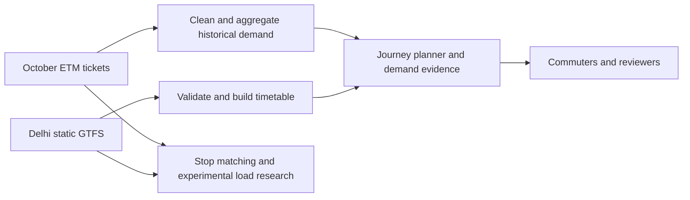

# SAFARNAMA Project Proposal

**Crowdedness-Aware Delhi Bus Journey Planner**

Team SAFARNAMA · Transport Stack Hackathon 2026 · Problem Statement 2 · Phase 1

## Executive summary

SAFARNAMA helps Delhi bus commuters compare scheduled journeys and interpret historical ticket demand. The prototype combines the published GTFS timetable with a historical model built from October 2026 electronic ticket machine (ETM) records. It can show a direct or one-transfer itinerary, verified route geometry and historical ticketed passenger activity for a supported directional route and hour. Research also explores ticket-derived passenger loads on stretches. Deployment of crowding bands and comfort-based ranking requires validated trip assignments, independent passenger counts and vehicle capacity.

The project addresses the judging priorities through a traceable data pipeline and explicit explanations on the journey card. Reviewers can inspect how ticket events align with routes, how a simple model compared with CatBoost, and where the evidence stops supporting claims about comfort.

## Problem and objectives

Journey planners usually optimize for the clock. Commuters may also care about standing, space and uncertainty, especially when comparing an immediate trip with a later departure. The Phase 1 challenge asks for passenger loads by route, direction, segment and time; understandable crowding categories; a time-versus-comfort comparison; and evidence that can help operators. SAFARNAMA demonstrates the schedule, evidence and communication components and sets a validation path for the load-dependent features.

| Objective | Phase 1 result |
|---|---|
| Reproduce scheduled journeys | Direct and one-transfer options with Delhi service dates and actual GTFS stops |
| Communicate historical passenger demand | Route-hour values, descriptive variability and explicit unavailable states |
| Establish an auditable load methodology | Research patterns, candidate runs and conditional boarding/alighting bounds |
| Support transparent decisions | Timetable comparison and leg-level context. Comfort ranking depends on validated loads. |
| Support planning review | Network timetable patterns and route-hour demand for mapped routes |

## Proposed workflow and implementation

**Data and processing.** The organizer brief identifies the October Delhi ETM CSV ZIP and approximately 2.56 million ticket entries from 1–31 October. Fields include passenger counts, route, stop names, vehicle, ticket issue time, amount, ticket type and AC flag. Member 1's pipeline read CSV chunks, accepted positive whole passenger counts and valid essential fields, preserved rejected rows locally, and produced cleaned Parquet. GTFS contributes stop codes and coordinates, directional route labels, runs, stop order, service calendars and shapes. The production importer validates the ZIP and writes indexed SQLite. Raw ticket data and detailed vehicle-linked outputs stay outside the public repository.

**Matching and model.** V2 compares names within the same route, accepting unique exact and conservative fuzzy matches. V3 recovers uniquely resolvable components of compound GTFS names. The order check asks whether boarding precedes destination on a compatible scheduled pattern. Separately, historical ticket demand sums passengers per route, date and hour and averages over matching weekdays. That model provides a route-hour estimate with a descriptive standard deviation and an observed-day count.

**Journey experience.** A commuter selects two stops and Delhi departure time. The backend checks service calendars and overnight offsets, finds direct and feasible one-transfer options, removes equivalent schedules and ranks by arrival or a transfer penalty. The UI explains transfers and shows verified map shapes. Supported routes can show historical demand by time. The app supplies an explicit unavailable response for segment crowding and seats when no validated provider exists.

**Technology.** The interface uses React, Vite, Leaflet and Recharts. FastAPI, Pydantic and SQLAlchemy serve the indexed SQLite timetable and validated ML artifact. Pandas and RapidFuzz support the offline workflow; CatBoost is a comparison model. Docker Compose and Caddy package the local demo.

## Evaluation and judging evidence

| Measure | Evidence |
|---|---:|
| Imported network | 6,862 stops, 2,574 routes and 80,357 trips |
| Cleaned Member 1 ticket records | 1,317,730 |
| Cleaned ticketed passengers | 1,422,016 |
| V2 to V3 GTFS-ordered coverage | 55.30% to 62.76% |
| Historical mean versus CatBoost, top-20 WAPE | 29.52% versus 45.51% |
| Verified runtime demand coverage | 20 directional routes and 3,360 route-weekday-hour estimates |

The walkthrough uses the actual static feed. On **717AUP**, Friday at **08:00 IST**, the API returns **82.6 estimated ticketed passengers per route-hour**, verified against the delivered CSV. The interface shows a separate crowding status and gives a reason on unsupported routes. This demonstrates grounded information and clear communication without converting a historical aggregate into an onboard count. The reported model comparison used 1–24 October for training and 25–31 October for selection. That final week supplies comparative evidence, with no untouched test period. [Detailed results](docs/EVALUATION_AND_RESULTS.md)

## Impact and next steps

For commuters, timetable, transfer and demand context can support informed comparisons even where occupancy is unknown. For operators, published service patterns and route-hour demand may highlight periods for closer inspection. Those aggregates are useful for prioritizing investigation. Fleet allocation and comfort decisions need measured per-vehicle evidence.

The next milestone is to validate geographic stop matches and connect tickets to confirmed runs. Independent passenger counts and verified capacity would support segment categories, uncertainty calibration and comfort-aware routing. Expanded artifact coverage and an authorized live feed are separate goals. The current submission is a locally verified demonstration. Public deployment and a clean build on the target staging or Windows host remain outstanding. [Limitations](docs/LIMITATIONS_AND_FUTURE_WORK.md)

## References and source

- [Integrated submission repository](https://github.com/RISHI-0723/Safarnama)
- [Delhi Transport Stack data portal](https://delhi.transportstack.in)
- [GTFS Schedule Reference](https://gtfs.org/documentation/schedule/reference/)
- [Member 1 model-selection and validation evidence](ml/outputs/ML_VALIDATION_REPORT.md)
