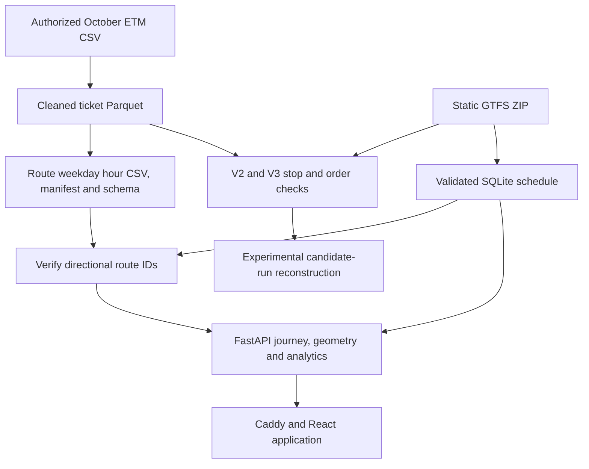

# SAFARNAMA Technical Note

**Data, Models and Journey Planning**

Team SAFARNAMA · Transport Stack Hackathon 2026 · Problem Statement 2 · Phase 1

## Abstract

SAFARNAMA integrates indexed Delhi static GTFS, a deterministic schedule planner and a validated historical ticket-demand artifact. The data workflow separately explores candidate vehicle-run reconstruction and conditional ticket-load bounds. The deployed predictor covers 20 of 2,574 directional GTFS routes. Its metric is estimated ticketed passengers per route-hour. Independent segment occupancy, capacity, and comfort-ranking evidence remains unavailable.

## Problem and architecture

The challenge calls for passenger-load estimates by route, direction, stretch and time, understandable crowdedness categories, and meaningful travel-time and comfort choices. The integrated application provides verified timetable routing and a traceable demand signal. It leaves independent segment crowdedness fields unavailable until there is defensible load evidence.

## Data acquisition, cleaning and GTFS

The challenge brief reports roughly 2.56 million October 2026 ticket records and references the organizer CSV ZIP. Raw processing requires authorized local access. The corresponding research records 1,317,730 cleaned tickets and 1,422,016 represented passengers. The raw archive was unavailable for a fresh end-to-end research run in the cloud workspace.

| Field | Use |
|---|---|
| `passenger_count` | Positive integer demand contribution |
| `created_at` | Ticket issue clock in IST, used to derive date, weekday and hour |
| `route`, `start_stop_name`, `end_stop_name` | Directional label and endpoint evidence |
| `vehicle_number` | Restricted identifier for experimental candidate grouping |
| `amount`, `ticket_type_id`, `is_ac` | Source context. No runtime fare or capacity inference. |

`clean_data.py` discovers local CSVs and reads 100,000 rows per chunk. It normalizes route, vehicle and stop strings, coerces numeric and datetime fields, and rejects invalid essential values. A missing destination can survive. The script assumes the provided clock is IST, has no explicit ticket deduplication, and concatenates accepted and rejected chunks to Parquet. The runtime interprets lookup time in Asia/Kolkata.

The GTFS importer reads archive members directly, validates operators, stop IDs, coordinates, calendar entries, trips, stop order and shape references, and stages the database before replacement. It records failures and the original checksum. The supplied archive yielded 6,862 stops, 2,574 routes, 80,357 trips, 2,737,136 stop-time records and 965,607 shape points. One recurring calendar covered all seven weekdays in the published validity range. The feed supplied no exception or transfer records. [Data dictionary](docs/DATA_DICTIONARY.md)

## Directional stop matching and load research

V2 normalizes names and limits candidate GTFS stops to the ticket's directional route. Unique exact names resolve directly. RapidFuzz ratio scores below 92 are rejected and nonunique candidates are marked ambiguous. V3 retains V2 matches and resolves a slash-separated name component only when it maps to one stop within the route. Order validation requires boarding before destination on at least one GTFS pattern.

| Share of cleaned tickets | V2 | V3 |
|---|---:|---:|
| Boarding matched | 70.76% | 76.43% |
| Destination matched | 69.94% | 76.16% |
| Both matched | 55.34% | 62.82% |
| Compatible stop order | 55.30% | 62.76% |
| Compatible records | 728,657 | 826,960 |

V3 leaves 489,900 records with at least one unresolved endpoint. A further 870 have both endpoints but fail order validation. Coverage does not establish geographic precision. Candidate runs split on a vehicle's route change, date change or gap over 45 minutes. Using V2 ordered records, the research compares patterns and computes conditional bounds across possible occurrences of repeated stops. A segment ticket-load estimate adds ticketed boardings and subtracts ticketed alightings along an assumed run. It depends on trip identity and the chosen pattern. Actual vehicle occupancy requires all relevant passengers, and meaningful crowding bands need verified capacity or calibrated observations. Live occupancy requires a validated current passenger source. Vehicle positions alone do not provide it. [Research methodology](docs/ML_METHODOLOGY.md)

## Demand model, evaluation and export

For route *r*, weekday *w* and hour *h*, the estimate is the arithmetic mean of the passenger-count sum per matching date. The pandas script constructs the cross product of routes, dates observed globally and calendar hours, and zero-fills an absent transaction cell. The export carries the mean, daily standard deviation and count of matching calendar dates. They describe a historical aggregate across all buses on the route-hour. A zero may reflect absent records, so service or reporting gaps can bias the signal.

| Top-20 model comparison | Historical mean | CatBoost |
|---|---:|---:|
| MAE | 4.243 | 6.542 |
| RMSE | 6.900 | 11.290 |
| WAPE | 29.52% | 45.51% |

WAPE is total absolute error divided by total actual demand. Training used 1–24 October and comparison used 25–31 October. Top-20 evaluation routes were selected from training demand. The comparison window informed model selection and is not an independent final test. The mean was refit over all of October. The demo handoff selects 20 routes and writes the historical grid, 3,360 predictions. The application verifies bytes against the manifest, permits the documented LF/CRLF normalization, validates the schema and checks the reviewed GTFS crosswalk. The API distinguishes unsupported routes, missing keys, invalid artifacts and legitimate zeroes. The demo response for 717AUP at Friday 08:00 is 82.6. [Results and coverage](docs/EVALUATION_AND_RESULTS.md)

## Planner, API and interface

SQLite stores operators, stops, calendars, exceptions, routes, trips, ordered stop times, shape points and transfer rules. The stop/departure composite index and trip/sequence key support schedule search. The planner resolves active service dates including GTFS times past 24:00, clamps same-day upcoming searches against the Delhi clock, and scans direct and one-transfer boardings within a bounded window. It enforces explicit transfer prohibitions and requires a positive published minimum when changing across distinct stops. It deduplicates by route, exact timing and ordered stops and ranks by arrival, with an optional transfer penalty.

FastAPI exposes timetable, geometry, demand, analytics, crowding status and process readiness. The React client displays schedule legs, stop markers, route geometry and transfer details independently of the historical estimate. The segment provider returns null passenger load and capacity when unvalidated. Caddy serves the app and proxies API traffic on one origin. The dashboard separates scheduled counts from historical demand. [API guide](docs/API_DOCUMENTATION.md)

## Testing, reproducibility and remaining work

The verified release candidate passed 37 backend tests, 43 ML tests and 14 Chromium tests. Coverage includes timetable validity, overnight search, duplicate removal, unavailable states, maps and responsive screens. The production frontend build, Compose validation and API probes passed. Browser tests used the real imported Delhi data and the original persistent volume, plus intentional error-path fixtures. Runtime verification reused an existing Docker container. The test report records the clean-build and external-data limits.

Run the documented setup and data validation to reproduce the demo. Full research regeneration needs the authorized October CSV and local intermediate reports. Key assumptions are that the ticket issue clock follows IST, GTFS captures scheduled service and the exact directional crosswalk is valid for the shipped feed. Passholders, clock differences, inconsistent destinations and missing transactions can bias the historical signal. Future work requires a temporal holdout after model selection, independent physical-trip matching and ground truth for segment loads and capacities. [Reproducibility](docs/REPRODUCIBILITY.md) · [Final verification](docs/FINAL_TEST_REPORT.md)

## References

- [Integrated submission and source](https://github.com/RISHI-0723/Safarnama)
- [Delhi Transport Stack data portal](https://delhi.transportstack.in)
- [GTFS Schedule Reference](https://gtfs.org/documentation/schedule/reference/)
- [Member 1 validation evidence](ml/outputs/ML_VALIDATION_REPORT.md)
