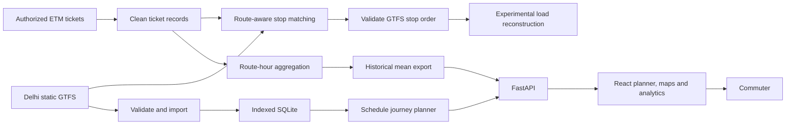

# SAFARNAMA | Crowdedness-Aware Delhi Bus Journey Planner

**Transport Stack Hackathon 2026 · Problem Statement 2 · Phase 1**

SAFARNAMA combines Delhi's static bus timetable with historical electronic ticket machine (ETM) data. Commuters can compare scheduled journeys, see where to transfer and check the historical ticket demand for covered routes. The Phase 1 prototype displays evidence and coverage so users can tell when information about comfort is unavailable.

## Problem

Journey planners usually rank routes by duration or transfers. That serves time-sensitive decisions but gives commuters little context on passenger demand. Historical ticket counts can show when a route tends to see more ticketed activity. Reliable crowdedness-aware ranking needs separately validated passenger-load estimates for individual stretches.

## Solution and features

The schedule planner uses the imported GTFS feed for routing and maps. A
separate historical-demand service gives covered journeys context about
ticket activity.

- Find direct and one-transfer journeys, ranked by scheduled arrival or with a transfer penalty.
- Inspect Delhi-time schedules, stop-by-stop itineraries and verified GTFS map geometry.
- Look up historical ticket demand by directional route, weekday and hour, with observation counts and variability when available.
- Explore network statistics, scheduled services and historical demand coverage.
- See explicitly when a route or trip segment lacks evidence.

## Architecture



## Technology stack and integration

| Layer | Tools and responsibilities |
|---|---|
| Frontend | React, Vite, Axios, Leaflet and Recharts serve journey searches, maps and analytics. |
| Backend | Python 3.12, FastAPI, Pydantic, SQLAlchemy and SQLite validate input, query scheduled service, and serve data and historical estimates. |
| ML | Pandas and RapidFuzz support ticket processing and stop matching. CatBoost is the evaluation comparison. The runtime uses the historical mean. |
| Deployment and verification | Docker Compose and Caddy serve the app locally. Pytest and Playwright exercise the runtime. |

The React planner fetches schedules and geometry through FastAPI backed by
the imported SQLite timetable. The historical adapter checks the model
manifest, response schema and directional GTFS crosswalk before returning
an estimate. The frontend presents demand and segment crowding separately.
[Architecture](docs/ARCHITECTURE.md) · [API guide](docs/API_DOCUMENTATION.md)

## Data and ML methodology

Authorized October 2026 ETM records are cleaned and aggregated into
route-weekday-hour means. Stop matching and GTFS order validation support
separate load experiments. On the held-out top-20 comparison, the
historical mean achieved 29.52% WAPE versus 45.51% for CatBoost. That
window informed model selection. The shipped model was refit using the
full month and covers 20 mapped directional GTFS routes.
[Data pipeline](docs/DATA_PIPELINE.md) · [ML evaluation](docs/ML_EVALUATION_REPORT.md)

## Repository structure

| Path | Role |
|---|---|
| `01_PROJECT_PROPOSAL.md`, `02_TECHNICAL_NOTE.md` | Hackathon submission documents |
| `src/`, `public/` | Frontend source and static assets |
| `backend/` | FastAPI, GTFS import, SQLite access and backend tests |
| `ml/` | Research, predictor, validated demo artifact, manifest and tests |
| `scripts/`, `tests/` | Setup, data checks and browser tests |
| `deploy/`, `compose.yaml` | Container images, Caddy and persistent data configuration |
| `docs/` | Technical documentation and verification evidence |

## Setup and environment

Install Docker with Compose v2 for the container setup. Create `feeds/` and
place the authorized archive at `feeds/delhi_buses_static_gtfs_v1.zip`.
Use `.env.example` as the template for local Compose settings.
Compose defaults to a loopback address. Keep credentials in an untracked
local environment file. The live feed stays disabled by default and
requires authorized credentials. [Environment configuration](docs/REPRODUCIBILITY.md)

## Run the demo

Run from the repository root for a **first installation**.

```sh
cp .env.example .env
docker compose build
docker compose run --rm backend python -m scripts.import_gtfs \
  /feeds/delhi_buses_static_gtfs_v1.zip --database /data/safarnama.db \
  --report /data/ingestion_report.json
docker compose up -d --wait
curl -fsS http://127.0.0.1:8080/ready
```

Open `http://127.0.0.1:8080`. For a known transfer example, choose **Anand Vihar ISBT → Shivaji Stadium Terminal**, **23 November 2026 at 08:35 IST**, using historical timetable mode when the date has passed. For a demand example, use **Badarpur Border (T) → Kapashera Crossing**, stop code `EA96DE52`, on **27 November 2026 at 08:35 IST**, then expand a direct **717AUP** journey. For an existing Docker installation, retain the Compose project and database volume on upgrade. [Deployment and Windows setup](docs/DEPLOYMENT_GUIDE.md)

## Local development and tests

Local development uses Python 3.12, Node 22.12+ and Bash. Run `scripts/setup`,
then `scripts/import_gtfs feeds/delhi_buses_static_gtfs_v1.zip` for a new local
database. Start `scripts/run_backend` and `scripts/run_frontend` in separate
terminals. [Local setup and reproducibility](docs/REPRODUCIBILITY.md)

```sh
scripts/run_tests
```

To include Chromium, install it with `npx playwright install chromium` and
set `SAFARNAMA_TEST_ORIGIN` to the running app, such as
`http://127.0.0.1:8080` for Compose.

## Verified results

| Measure | Result |
|---|---:|
| Static GTFS | 6,862 stops, 2,574 routes, 80,357 trips |
| Schedule detail | 2,737,136 stop times, 965,607 shape points |
| Member 1 historical processing | 1,317,730 cleaned tickets representing 1,422,016 ticketed passengers |
| V3 ordered stop pairs | 826,960 records, 62.76% of cleaned tickets |
| Historical demo coverage | 20 directional routes, 3,360 route-weekday-hour estimates |
| Top-20 model selection WAPE | 29.52% historical mean, 45.51% CatBoost |

The matching and model-selection figures come from the preserved research
reports. Import, demo coverage and runtime lookup can be checked
independently. [Evaluation and results](docs/EVALUATION_AND_RESULTS.md)

Repository verification passed 37 backend and 43 ML tests, the frontend
production build, and Compose configuration validation. The previous
end-to-end hackathon run passed 14 Chromium tests on the imported Delhi
feed. [Final test report](docs/FINAL_TEST_REPORT.md)

## Limitations

The ticket-demand estimate represents historical ticket activity across
trips in a route-hour. Validated segment occupancy, available seats and
comfort ranking remain unavailable. The prototype was verified for local
demonstration. A fresh production deployment and end-to-end authorized
live-feed check remain unverified. [Limitations and future work](docs/LIMITATIONS_AND_FUTURE_WORK.md)

## Submission documents

- [Project proposal](01_PROJECT_PROPOSAL.md)
- [Technical note](02_TECHNICAL_NOTE.md)

## Technical documentation

- Engineering · [Architecture](docs/ARCHITECTURE.md) · [Data pipeline](docs/DATA_PIPELINE.md) · [Data dictionary](docs/DATA_DICTIONARY.md) · [API guide](docs/API_DOCUMENTATION.md)
- Evidence · [ML methodology](docs/ML_METHODOLOGY.md) · [Evaluation](docs/EVALUATION_AND_RESULTS.md) · [Limitations](docs/LIMITATIONS_AND_FUTURE_WORK.md) · [References](docs/REFERENCES.md)
- Verification · [Final tests](docs/FINAL_TEST_REPORT.md) · [Deployment guide](docs/DEPLOYMENT_GUIDE.md) · [Security audit](docs/SECURITY_AUDIT.md)

## Related ML research and contribution

This repository is the single hackathon submission and contains the integrated application and ML code. The related repository contains ML research and development contributions. [Related ML research and contribution](https://github.com/PriyankaEaty14/Safarnama)
