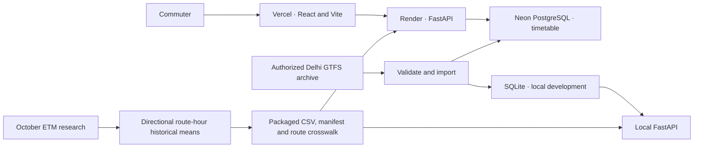

# SAFARNAMA — Crowdedness-Aware Delhi Bus Journey Planner

**Transport Stack Hackathon 2026 · Problem Statement 2 · Phase 1**

Plan Delhi bus journeys using published schedules, compare direct and
one-transfer options, and explore how historical ticket demand varies across
covered routes and hours. **[Open the live journey planner](https://safarnama-eosin.vercel.app/)**

## Live application

| Service | Link |
|---|---|
| Website · Vercel | [Open SAFARNAMA](https://safarnama-eosin.vercel.app/) |
| Backend API · Render | [API origin](https://safarnama-api-s6zs.onrender.com/) · [Interactive API docs](https://safarnama-api-s6zs.onrender.com/docs) |
| API readiness | [Check timetable readiness](https://safarnama-api-s6zs.onrender.com/ready) |
| Source and submission | [GitHub repository](https://github.com/RISHI-0723/Safarnama) |

The Vercel frontend calls the separately hosted Render backend over HTTPS.
The backend uses Neon PostgreSQL for hosted timetable data. The API origin
is the base URL. Open `/docs` for the interactive reference or use the
`/api/v1` routes for data. Render Free services can take longer to respond
after inactivity. [Deployment guide](docs/DEPLOYMENT_GUIDE.md) · [Render Free service behavior](https://render.com/docs/free)

## The commuter problem

Delhi bus riders need to compare scheduled departures, transfers and journey
times across a large network. A timetable gives them a basis for choosing a
route, while past ticket activity can add context about recurring demand.
Understanding how crowded an individual bus is requires separate vehicle and
segment observations.

## What SAFARNAMA delivers

- Search for boarding and alighting stops and plan journeys in Delhi time.
- Compare direct and one-transfer itineraries using **Fastest** or **Balanced**. Balanced applies a transfer penalty to the schedule ranking.
- Inspect boarding, alighting and transfer details, with route geometry from published GTFS shapes.
- Explore stops, routes, scheduled departures and network analytics.
- See historical ticket-demand estimates for verified directional route and hour combinations. The UI gives an explicit unavailable status when demand or segment crowding lacks evidence.

## Screenshots

*Gallery placeholder.* The repository currently contains illustrations and stop
thumbnails. Future screenshots can go under `docs/screenshots/` with captions
for the journey planner, route explorer and network analytics. [View the live interface](https://safarnama-eosin.vercel.app/)

## System architecture



| Layer | Technologies |
|---|---|
| Frontend | React, Vite, Axios, React Router, Leaflet and Recharts |
| Backend | Python 3.12, FastAPI, Pydantic, SQLAlchemy and Psycopg 3 |
| Database | Neon PostgreSQL for hosting and SQLite for local development |
| Data engineering | GTFS ZIP/CSV validation, service calendars, ordered stop times and shape import |
| Machine learning | Pandas and RapidFuzz for research preparation, historical mean for inference, CatBoost for comparison |
| Deployment | Vercel frontend, Render Docker backend, Docker Compose and Caddy for local operation |
| Testing | Pytest and Playwright with Chromium |

[Architecture and request flow](docs/ARCHITECTURE.md) · [API documentation](docs/API_DOCUMENTATION.md)

## Delhi GTFS import

The completed import report records the following counts. The hosted analytics
endpoint returned the same agency, stop, route, trip and stop-time counts on
24 November 2026. [Committed import report](backend/data/ingestion_report.json) · [Live analytics API](https://safarnama-api-s6zs.onrender.com/api/v1/analytics)

| Dataset | Imported records |
|---|---:|
| Agencies | 2 |
| Stops | 6,862 |
| Routes | 2,574 |
| Calendars | 1 |
| Trips | 80,357 |
| Stop times | 2,737,136 |
| Shape points | 965,607 |
| Calendar dates | 0 |
| Transfers | 0 |
| Rejected records | 0 |

Zero transfer records means the supplied feed has no explicit GTFS transfer
entries. The planner can still infer same-stop connections between scheduled
legs, applying boarding order, service calendars and wait-time constraints.
[Journey planner validation](docs/JOURNEY_PLANNER_VALIDATION.md)

## Historical demand methodology

The research cleans October 2026 electronic ticket machine (ETM) records,
matches stops to directional GTFS routes, checks the order of matched stops,
and aggregates ticketed passengers by route, weekday and hour. The published
research comparison trained on 1–24 October and used 25–31 October for model
selection. On its top-20 slice, the historical mean achieved 29.52% weighted
absolute percentage error (WAPE), compared with 45.51% for CatBoost. The
selected mean was refit on the full month.

The hosted coverage API reported **20 mapped directional routes and 3,360
route-weekday-hour estimates**. These estimates represent historical ticketed
activity across trips on a route-hour. Actual live occupancy requires
vehicle-level boarding and alighting observations, trip identity, and
capacity evidence. [Data pipeline](docs/DATA_PIPELINE.md) · [ML evaluation](docs/ML_EVALUATION_REPORT.md) · [Live coverage API](https://safarnama-api-s6zs.onrender.com/api/v1/demand/coverage?limit=1)

## Repository structure

| Path | Contents |
|---|---|
| `src/`, `public/` | React frontend and static assets |
| `backend/` | FastAPI, database adapters, GTFS importer, Dockerfile and backend tests |
| `ml/` | Research, inference code, validated demand export, manifest and ML tests |
| `scripts/`, `tests/` | Local setup, data validation and browser tests |
| `deploy/`, `compose.yaml` | Caddy and local container deployment |
| `docs/` | Technical documentation and verification evidence |
| `01_PROJECT_PROPOSAL.md`, `02_TECHNICAL_NOTE.md` | Hackathon submission documents |

## Configuration and local setup

| Variable | Purpose |
|---|---|
| `VITE_API_BASE_URL` | Public API prefix set at frontend build time. The hosted prefix is `https://safarnama-api-s6zs.onrender.com/api/v1`. |
| `SAFARNAMA_DATABASE_URL` | Server-side database connection. Render uses Neon PostgreSQL. The local backend defaults to SQLite. |
| `SAFARNAMA_CORS_ORIGINS` | Server-side list of trusted frontend origins. The hosted frontend origin is `https://safarnama-eosin.vercel.app`. |

Use Python 3.12, Node 22.12 or later, and Bash for the setup scripts. Install
Docker with Compose v2 for the combined verification command. Keep credentials
in the server environment and use the environment examples as references.
Obtain the authorized GTFS ZIP separately and place it in `feeds/`.
[Reproducibility guide](docs/REPRODUCIBILITY.md)

```bash
git clone https://github.com/RISHI-0723/Safarnama.git
cd Safarnama
mkdir -p feeds
# Place delhi_buses_static_gtfs_v1.zip in feeds/ before importing.
scripts/setup
scripts/validate_data feeds/delhi_buses_static_gtfs_v1.zip
scripts/import_gtfs feeds/delhi_buses_static_gtfs_v1.zip
scripts/run_backend --host 127.0.0.1 --port 8000
```

Setup installs pinned backend dependencies in `backend/.venv` and runs
`npm ci`. The import creates a local SQLite timetable. For local SQLite, leave
`SAFARNAMA_DATABASE_URL` unset. Serving the frontend through the Vite proxy
uses the same browser origin. [Environment example](.env.example) In a second terminal
at the repository root, use the Vite proxy to reach the backend:

```bash
SAFARNAMA_BACKEND_ORIGIN=http://127.0.0.1:8000 scripts/run_frontend
```

Open `http://localhost:5173`. For the standalone verification suite, run
`scripts/run_tests`. To include browser tests, install Chromium with
`npx playwright install chromium`, start the app with the imported feed and
run `SAFARNAMA_TEST_ORIGIN=http://127.0.0.1:5173 scripts/run_tests`.
[Local Docker setup](docs/DEPLOYMENT_GUIDE.md#local-or-staging) · [Test history](docs/FINAL_TEST_REPORT.md)

## Project status and limits

The public site and API are deployed. The 24 November 2026 checks verified
the site, API liveness and timetable readiness, Vercel-origin access and the
hosted historical-demand coverage. Schedule search and historical demand are
available now. The import and evaluation evidence is versioned alongside the
application. [Verification record](docs/FINAL_TEST_REPORT.md#hosted-smoke-checks)

The historical model covers the reviewed routes only. Validated live
occupancy, seat availability and comfort-aware ranking require additional
evidence. Live vehicle tracking depends on provider authorization and
configuration. Future work includes independent validation, broader demand
coverage and measured segment-level passenger load.
[Limitations and future work](docs/LIMITATIONS_AND_FUTURE_WORK.md)

## Submission and technical documentation

- [Project proposal](01_PROJECT_PROPOSAL.md) · [Technical note](02_TECHNICAL_NOTE.md)
- [Deployment guide](docs/DEPLOYMENT_GUIDE.md) · [Data dictionary](docs/DATA_DICTIONARY.md) · [Security audit](docs/SECURITY_AUDIT.md)
- [Related Member 1 ML research and contributions](https://github.com/PriyankaEaty14/Safarnama)
