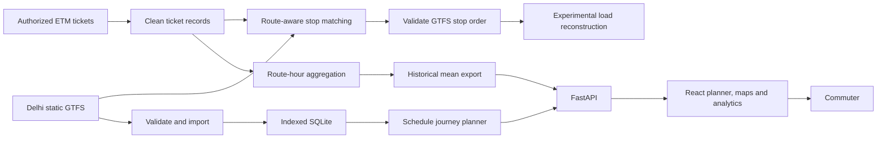

# SAFARNAMA | Crowdedness-Aware Delhi Bus Journey Planner

**Transport Stack Hackathon 2026 · Problem Statement 2 · Phase 1**

SAFARNAMA combines Delhi's static bus timetable with historical electronic ticket machine (ETM) data. Commuters can compare scheduled journeys, see where to transfer and check the historical ticket demand for covered routes. The Phase 1 prototype displays evidence and coverage so users can tell when information about comfort is unavailable.

## What it demonstrates

Journey planners usually rank routes by duration or transfers. That serves time-sensitive decisions but gives commuters little context on passenger demand. Historical ticket counts can show when a route tends to see more ticketed activity. Reliable crowdedness-aware ranking needs separately validated passenger-load estimates for individual stretches.

- Find direct and one-transfer journeys, ranked by scheduled arrival or with a transfer penalty.
- Inspect Delhi-time schedules, stop-by-stop itineraries and verified GTFS map geometry.
- Look up historical ticket demand by directional route, weekday and hour, with observation counts and variability when available.
- Explore network statistics, scheduled services and historical demand coverage.
- See explicitly when a route or trip segment lacks evidence.

## Architecture



## Verified results

| Measure | Result |
|---|---:|
| Static GTFS | 6,862 stops, 2,574 routes, 80,357 trips |
| Schedule detail | 2,737,136 stop times, 965,607 shape points |
| Member 1 historical processing | 1,317,730 cleaned tickets representing 1,422,016 ticketed passengers |
| V3 ordered stop pairs | 826,960 records, 62.76% of cleaned tickets |
| Historical demo coverage | 20 directional routes, 3,360 route-weekday-hour estimates |
| Top-20 model selection WAPE | 29.52% historical mean, 45.51% CatBoost |

The matching and model-selection figures come from the preserved research reports. Import, demo coverage and runtime lookup can be checked independently. The demo serves historical ticket activity across all trips on a route-hour. It supplies no verified segment occupancy, seat counts or comfort ranking. Live vehicle positions require authorized access. [Results and limitations](docs/EVALUATION_AND_RESULTS.md)

## Run the demo

Install Docker with Compose v2. Place the authorized Delhi static GTFS archive at `feeds/delhi_buses_static_gtfs_v1.zip`. Run from the repository root for a **first installation**.

```sh
cp .env.example .env
docker compose build
docker compose run --rm backend python -m scripts.import_gtfs \
  /feeds/delhi_buses_static_gtfs_v1.zip --database /data/safarnama.db \
  --report /data/ingestion_report.json
docker compose up -d --wait
curl -fsS http://127.0.0.1:8080/ready
```

Open `http://127.0.0.1:8080`. For a known transfer example, choose **Anand Vihar ISBT → Shivaji Stadium Terminal**, **23 November 2026 at 08:35 IST**, using historical timetable mode when the date has passed. For a demand example, use **Badarpur Border (T) → Kapashera Crossing**, stop code `EA96DE52`, on **27 November 2026 at 08:35 IST**, then expand a direct **717AUP** journey. For an existing Docker installation, retain the Compose project and database volume on upgrade. [Deployment and Windows setup](docs/DEPLOYMENT_GUIDE.md)

## Code and verification

| Path | Role |
|---|---|
| `src/`, `public/` | React and Vite frontend, Axios API client, Leaflet maps and Recharts analytics |
| `backend/` | Python 3.12, FastAPI, Pydantic, SQLAlchemy, SQLite and GTFS import |
| `ml/` | Pandas and RapidFuzz processing, CatBoost comparison, reports and validated demo artifact |
| `scripts/`, `tests/` | Setup, data validation and Playwright/Chromium automation |
| `deploy/`, `compose.yaml` | Caddy, application containers and the persistent Transit volume |
| `docs/`, `feeds/` | Submission and evidence. Place the feed in the ignored local `feeds/` directory. |

Local development uses Python 3.12, Node 22.12+, Bash and `scripts/setup`. Run the backend and frontend in separate terminals using `scripts/run_backend` and `scripts/run_frontend` after importing the feed.

```sh
npx playwright install chromium
SAFARNAMA_TEST_ORIGIN=http://127.0.0.1:8080 scripts/run_tests
```

The verified code passed 37 backend, 43 ML and 14 Chromium tests. The web build and Compose configuration validated. The demonstration used the imported feed in an existing Docker runtime. A clean image rebuild remains unverified in the limited cloud workspace. [Reproducibility](docs/REPRODUCIBILITY.md) · [Test report](docs/FINAL_TEST_REPORT.md)

## Submission documents

- [Project proposal](docs/01_PROJECT_PROPOSAL.md)
- [Technical note](docs/02_TECHNICAL_NOTE.md)
- Engineering · [Architecture](docs/ARCHITECTURE.md) · [Data pipeline](docs/DATA_PIPELINE.md) · [Data dictionary](docs/DATA_DICTIONARY.md) · [API guide](docs/API_DOCUMENTATION.md)
- Evidence · [ML methodology](docs/ML_METHODOLOGY.md) · [Evaluation](docs/EVALUATION_AND_RESULTS.md) · [Limitations](docs/LIMITATIONS_AND_FUTURE_WORK.md) · [References](docs/REFERENCES.md)

## Related ML research and contribution

This repository is the single hackathon submission and contains the integrated application and ML code. The related repository contains ML research and development contributions. [Related ML research and contribution](https://github.com/PriyankaEaty14/Safarnama)
