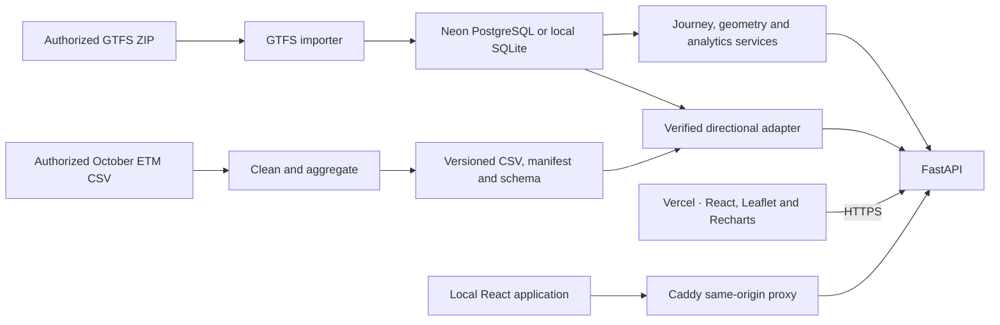
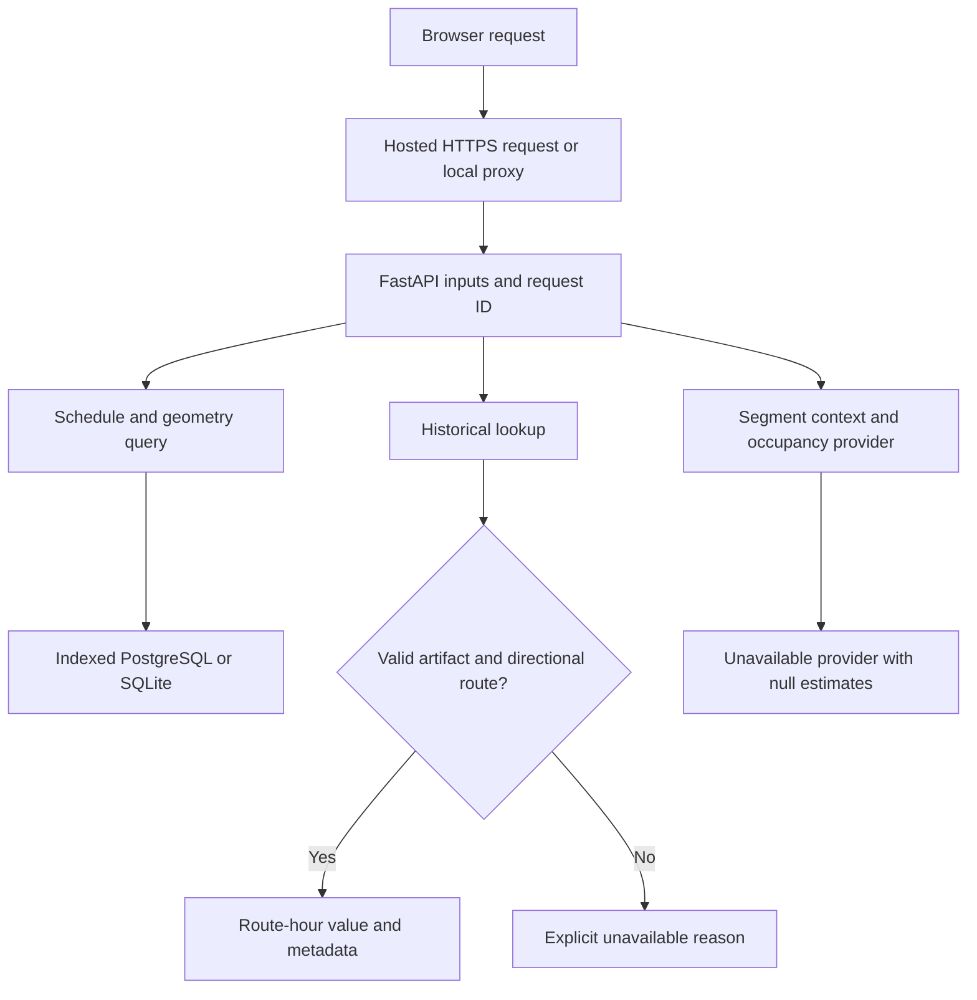
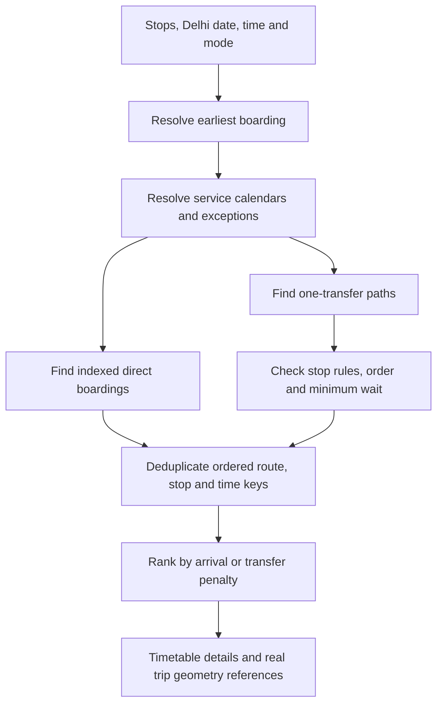

# System architecture

SAFARNAMA uses static GTFS for journeys and a separate historical ticket-demand artifact for optional context. The raw ticket pipeline is offline. Its candidate-load experiments have no production data path.

## Request and validation flow

## Journey planning

FastAPI uses SQLAlchemy and database indexes for stops, departure ranges and
ordered trip calls. Route geometry comes from stored GTFS shapes. Lower-cost
schedule requests and health checks are independent of the optional historical
artifact and live feed. [Deployment guide](DEPLOYMENT_GUIDE.md)

The React interface lazy-loads its Leaflet explorer and Recharts dashboard.
Expanded journey cards share identical route-day-hour demand lookups within
the itinerary and cancel them when details close or search inputs change.
The importer stages the SQLite replacement beside the current file and checks
relationships before replacing it. PostgreSQL imports validate within a
transaction before committing the feed. These boundaries keep timetable search
usable when an optional prediction source or external map layer is unavailable.
[Integration provenance](INTEGRATION_REPORT.md)
