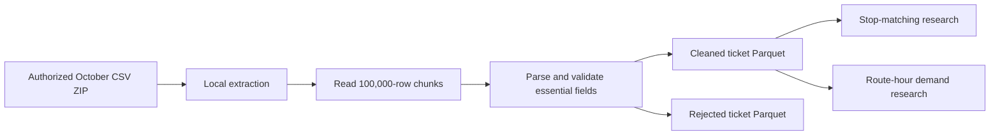
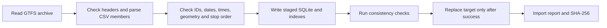
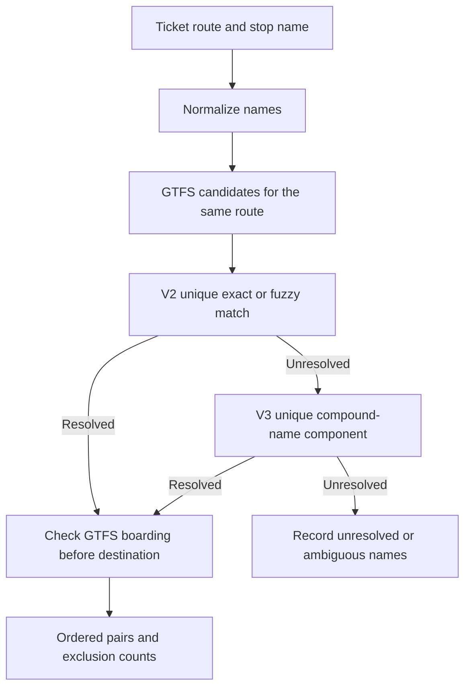

# Data extraction and processing

## Ticket acquisition and cleaning

The hackathon brief identifies the official October Delhi CSV ZIP and
describes approximately 2.56 million tickets from 1–31 October 2026. Member 1
used October ETM records, with 1,317,730 cleaned tickets representing
1,422,016 ticketed passengers in the recorded research outputs. The full raw
archive could not be transferred into this verification workspace. The raw
headline and processed totals have distinct provenance, and the difference
cannot be used as an exact rejected count. Obtain the raw file through the
authorized channel and keep raw rows and vehicle-linked intermediates local.
[Sources](REFERENCES.md)

`clean_data.py` recursively discovers CSVs in `ml/data/raw/`, reads 100,000 rows
per chunk, parses counts and timestamps, trims column names, and uppercases
vehicle, route and stop text. It accepts integer passenger counts above zero
and requires a usable timestamp, route, vehicle and boarding stop. A missing
destination can survive cleaning. Date, hour, weekday and weekend flags are
derived from the source IST clock. This script assumes the input clock is IST
and performs no explicit timezone conversion or ticket deduplication. It
stores accepted and rejected chunks in memory until final concatenation.
Chunked reading limits per-read work, with final memory use still dependent
on dataset size. [Cleaning source](../ml/src/clean_data.py)

## Static GTFS ingestion

The separate production importer reads members directly from the ZIP, validates
required fields and relationships, records omissions and row failures, and
builds a staged SQLite database beside the target. It preserves service-relative
times past 24:00 and separate recurring calendars and exceptions. The imported
feed declares all seven weekdays for service 1, from 2025-01-01 through
2040-01-01, with no exception or transfer records. This describes published
service, with actual operations subject to timetable changes. [GTFS data dictionary](DATA_DICTIONARY.md) · [Import evidence](../backend/data/ingestion_report.json)

## Route-aware matching and order

V2 accepts unique route-specific exact matches and uses RapidFuzz
`fuzz.ratio` with a cutoff of 92 for conservative fallback. The selected
normalized name must map to one stop ID. V3 preserves existing resolutions
and recovers unresolved names that uniquely match one slash-delimited
component within the same route. Order validation establishes a compatible
GTFS trip pattern and rejects same-stop or reversed/unmatched pairs.
Independent geographic accuracy and physical trip assignment remain open.
[Matching results](EVALUATION_AND_RESULTS.md)
