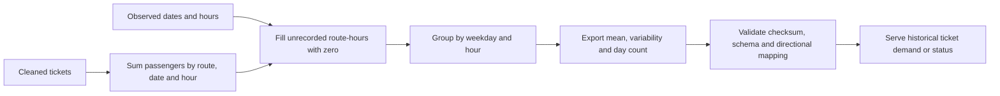

# Machine-learning methodology

## Historical ticket demand

The selected model averages the total ticketed passenger counts for each
directional ETM route, weekday and Delhi hour. The offline script builds a
rectangle of routes, dates seen anywhere in the cleaned input, and hours 0–23.
A route-hour with no transaction in that rectangle is counted as zero.
This aligns train and test features, but can understate demand where data or
service coverage is incomplete. The descriptive standard deviation comes
from the calendar-day counts. No interval, probability or confidence
calibration is supplied.

Member 1 evaluated the historical mean and CatBoost chronologically,
using 1–24 October for fitting and 25–31 October for model selection.
Routes in the top-20 evaluation slice were selected from training
demand. The mean won on MAE, RMSE and WAPE. The shipped demo was refit
on 1–31 October. The handoff script selects 20 routes and writes the
3,360-row CSV. The final handoff generator adds metadata, SHA-256,
schema and response examples. The full research export is not distributed
here. [Evaluation and artifact provenance](EVALUATION_AND_RESULTS.md)

The adapter verifies the reviewed directional GTFS crosswalk and resolves
the lookup in Asia/Kolkata. An absent route or key returns a status and
null estimate. An actual recorded aggregate mean of zero remains zero.
The frontend displays the source, model, schema version,
and descriptive variability where available. [Coverage and API outcomes](ML_EVALUATION_REPORT.md)

## Experimental ticket-led load

The reconstruction uses V2 ordered tickets. It groups chronological tickets
per vehicle and starts a new candidate when the route or date changes, or
when the gap exceeds 45 minutes. The research compares compatible route
patterns, accounts for boarding and destination order and computes
conditional load bounds when repeated stops give multiple valid placements.
For an ordered pattern, ticket-derived load after a stop is prior load plus
ticketed boardings less ticketed alightings. That requires correct route
direction, stop alignment and a physical trip assignment. The groups remain
heuristics and the bounds describe ticket interpretations, without an
independently calibrated occupancy interval. There is no verified capacity,
seat count, automatic passenger count or trip cross-check. This research is
outside the runtime prediction adapter. [Research validation](../ml/outputs/ML_VALIDATION_REPORT.md)
